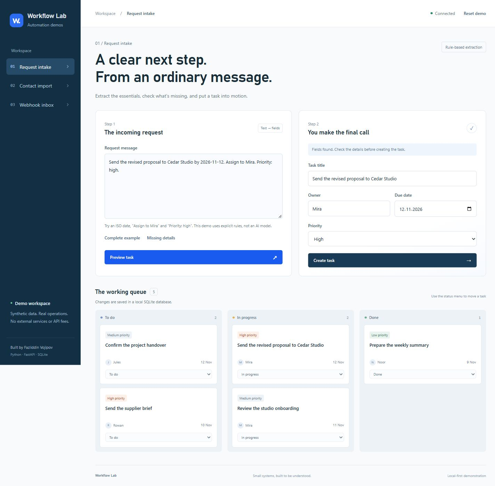
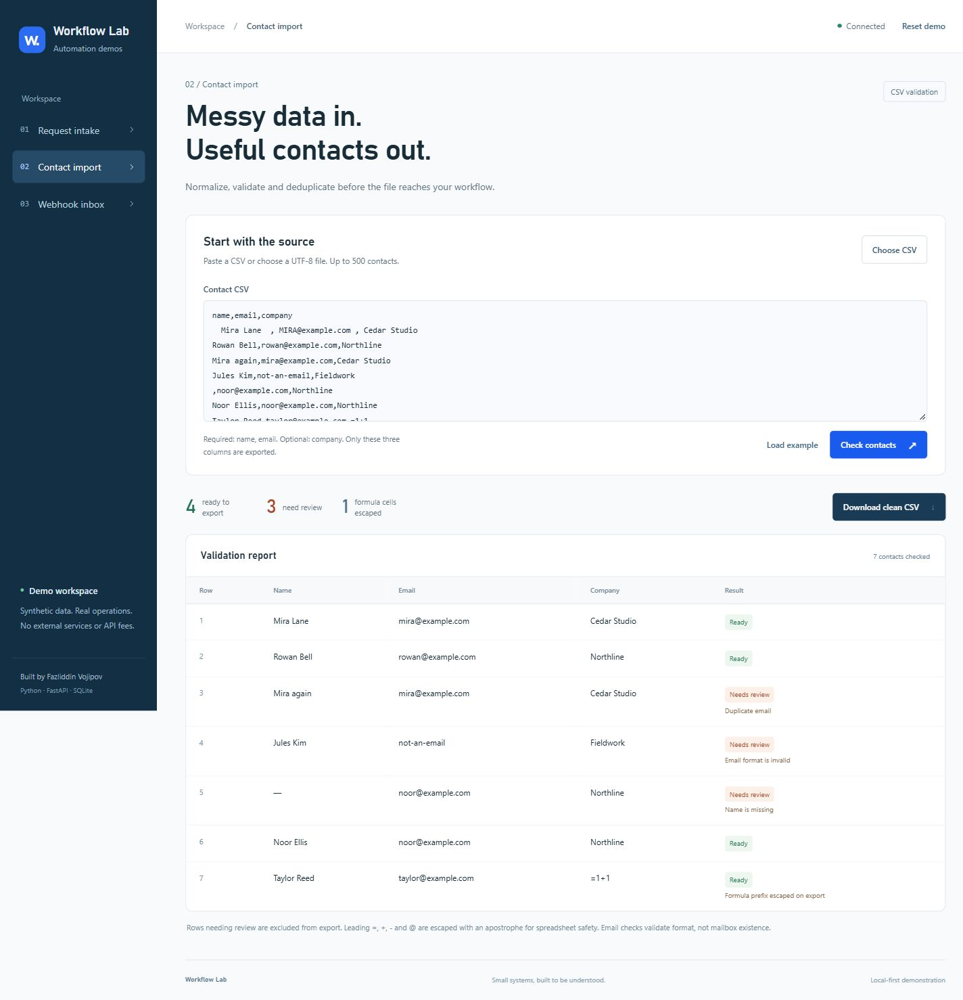
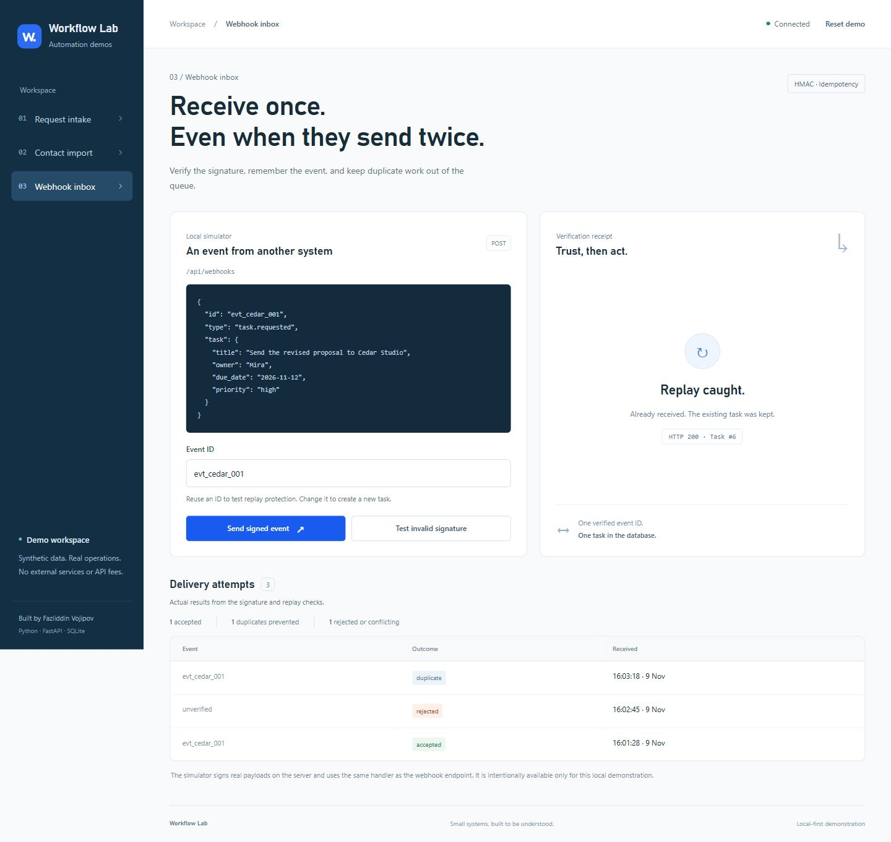
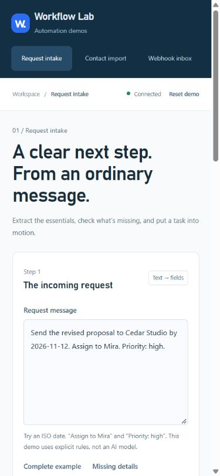

# Workflow Lab

**Three working automation demos, one small operations workbench.**

A request becomes a reviewed task. A messy contact list becomes a clean CSV. A signed event becomes one task, even if it arrives repeatedly.

Built by **Fazliddin Vojipov** with Python, FastAPI, SQLite and plain JavaScript. No paid APIs, frontend build step or cloud account required.

## What you can try

| Demo | Working behavior | Engineering detail |
| --- | --- | --- |
| **Request intake** | Extract an owner, ISO date and priority; correct the fields; save and move tasks between columns. | Server validation, explicit missing fields, SQLite persistence. The extractor is deterministic, **not an AI model**. |
| **Contact import** | Paste or upload a UTF-8 CSV, review errors, download the ready contacts. | Quoted CSV fields, normalized emails, case-insensitive deduplication and spreadsheet-formula escaping. |
| **Webhook inbox** | Send a signed event, replay it, then try an invalid signature. Inspect actual receipts and history. | HMAC-SHA256 verification, atomic event deduplication, payload-conflict detection and a real database transaction. |

All names, organizations and contacts shown are synthetic. The screenshots come from the running application, not design mockups. This is an original portfolio demonstration, not a client deployment.

## Run locally

Tested on Python 3.11 and Windows with a Chromium browser.

~~~sh
git clone https://github.com/Nagibator9669/workflow-lab.git
cd workflow-lab
python -m venv .venv
~~~

Activate the virtual environment:

~~~powershell
# Windows PowerShell
.\.venv\Scripts\Activate.ps1
~~~

~~~sh
# macOS / Linux
source .venv/bin/activate
~~~

Then install and start:

~~~sh
python -m pip install -r requirements.txt
python app.py
~~~

Open **http://127.0.0.1:8787**. Tasks and event history are stored in the ignored local file `data/workflow-lab.sqlite3`. CSV contents are processed in memory and are not written to this database.

If PowerShell disallows activation, use `.venv\Scripts\python.exe` directly for the install and start commands; there is no need to change system execution policy.

## A two-minute walkthrough

1. **Request intake:** click **Preview task**, inspect the fields and choose **Create task**. Change its status in the queue. Try **Missing details** to see that the demo asks for an owner and date instead of inventing them.
2. **Contact import:** choose **Check contacts**. The bundled example produces **4 ready contacts, 3 rows needing review and 1 escaped formula cell**. Download the clean CSV; the duplicate and invalid rows are excluded.
3. **Webhook inbox:** choose **Send signed event** twice with the same ID. The first receipt is 201; the next is 200 and points to the same task. **Test invalid signature** produces 401 and creates no task. Change the ID to send a new event.

Use **Reset demo** to remove the synthetic tasks and delivery history and restore the four starting tasks. Refreshing the page preserves database changes.

Contact import screenshot

Webhook verification and replay screenshot

Phone layout

## Implementation

The application deliberately keeps the moving parts small:

~~~text
static/index.html + style.css + app.js
                  │ same-origin JSON
                  ▼
              FastAPI
       ┌──────────┼──────────┐
   rule parser  CSV check  HMAC verification
       │                      │
       └──────── SQLite ──────┘
~~~

The webhook event ID and task creation are handled inside one `BEGIN IMMEDIATE` transaction. Concurrent repeats cannot pass the “not yet seen” check independently. A repeat with the same normalized payload returns the existing task; reusing an ID for different task content returns **409**, rather than silently accepting the change.

HMAC verification happens **before** JSON parsing or writes to the task table. The signature uses the raw request bytes; the deduplication fingerprint uses validated, canonical JSON. This allows equivalent JSON formatting to deduplicate while still verifying the actual transmitted payload.

Contact exports prefix potentially executable spreadsheet cells with an apostrophe. Validation only checks email **format**, not whether a mailbox exists. The export includes only `name`, `email` and `company`; additional source columns are intentionally discarded.

| Endpoint | Purpose |
| --- | --- |
| `GET /api/state` | Tasks, live counts, last 20 delivery attempts and sample payload. |
| `POST /api/intake/preview` | Extract explicit fields without saving a task. |
| `POST /api/tasks` | Validate and save a task. |
| `PATCH /api/tasks/{id}` | Move a task to `new`, `in_progress` or `done`. |
| `POST /api/import/preview` | Validate CSV and return the safe export. |
| `POST /api/webhooks` | Verify `X-Lab-Signature: sha256=<hex HMAC>` and process an event. |
| `POST /api/events/simulate` | Local demonstration of valid, invalid and repeated deliveries. |
| `POST /api/reset` | Restore the synthetic workspace. |

The simulator uses the same verification and transaction handler as the webhook endpoint. Its JSON result includes the handler's HTTP status; the simulator wrapper itself returns 200. Direct webhook requests return the actual 201/200/401/409 status.

For an external *local* sender, set `WORKFLOW_SIGNING_SECRET` before starting and sign the exact request body using that shared secret. Otherwise a random process-local secret is generated. Never commit a real secret.

## Verification

~~~sh
python -m pip install -r requirements-dev.txt
python -m pytest -q
node --check static/app.js
~~~

**35 automated tests** cover task validation and persistence, CSV parsing and export safety, malformed inputs, signed payloads, conflicts, repeated deliveries and concurrent replay attempts.

Manual browser checks covered creating and moving tasks, missing-field review, a real CSV download, valid/invalid/replayed events and layouts at 1440, 390 and 320 CSS-pixel viewport widths. The tables and code samples scroll within their containers on narrow screens. Keyboard focus, labeled controls, a skip link and reduced-motion styles are included.

## Boundaries

This is a **single-user, loopback-only demonstration**. It has no authentication or tenant isolation; the simulator and reset endpoint are intentionally accessible. Do not expose it publicly or use real client records as-is. A hosted client system needs authentication, authorization, request throttling, deployment hardening and a production data-handling policy.

JSON writes require `Content-Length` and are limited to 200 KB; the importer accepts at most 500 rows / 120,000 characters. The rule parser understands only the explicit patterns described in the UI. No claim is made about arbitrary-language extraction, distributed exactly-once processing or production load.

Development was AI-assisted. The examples, screenshots and test results describe the implemented demo; no client outcomes, savings or production metrics are invented.
